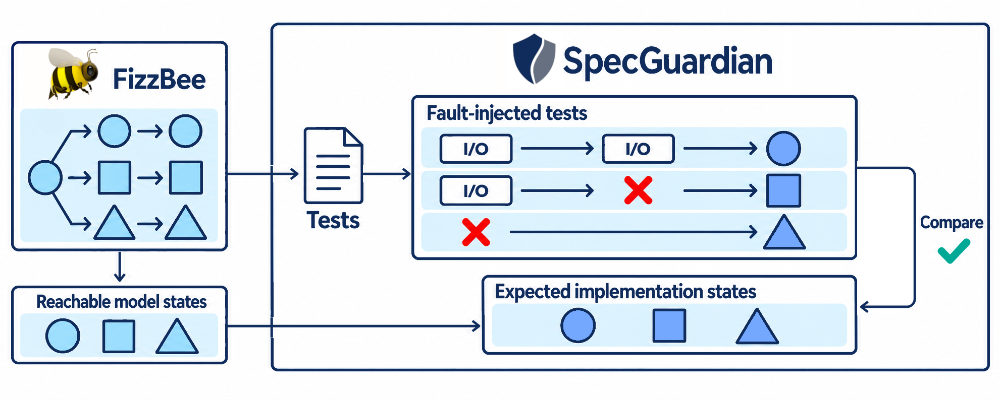

# Spec Guardian


Let formal specs test AI implementations.

A [FizzBee](https://fizzbee.io/) spec describes the state transitions your system allows. However, the spec alone does not test whether your implementation follows those transitions. SpecGuardian turns FizzBee's results into tests that check whether your implementation reaches an allowed state.

SpecGuardian lets you verify that an AI-generated implementation actually conforms to your specification.



## From Spec to Test: Cache-Aside

In this cache-aside example, a `Write` action stores a new value in the database, then invalidates the corresponding cache entry. The FizzBee spec describes what happens if either step fails:

```python
@conformance
role Application:
  fair action Write:
    db_succeeds = db.write(self.key, self.write_value)
    if not db_succeeds:
      self.write_status = RequestStatus.FAILED
      return

    delete_cache_succeeds = cache.delete_cache(self.key)
    if not delete_cache_succeeds:
      self.write_status = RequestStatus.FAILED
      return

    self.write_status = RequestStatus.DONE
```

SpecGuardian generates Go tests from FizzBee's results. They compare the observed state after the action with states allowed by the spec, including states reached when an I/O operation fails:

```go
func TestApplication_Write_Conformance(t *testing.T) {
  cases := LoadApplicationCases(t, "testdata/application_write_cases_generated.json")

  for _, testCase := range cases {
    t.Run(testCase.Name, func(t *testing.T) {
      controller := guardian.NewInjectionController("Application.Write")
      environment := NewApplicationConformanceEnvironment(t, controller)
      environment.PrepareWriteCase(t)

      input := environment.BuildWriteInput(t, testCase.Input)
      for faultNumber := range controller.Attempts() {
        t.Run(fmt.Sprintf("fault:%d", faultNumber), func(t *testing.T) {
          environment.PrepareWriteAttempt(t, testCase.Input)

          var actionOutput ApplicationWriteOutput
          var actionErr error
          func() {
            defer controller.InjectFaultAt(faultNumber)()
            actionOutput, actionErr = environment.ExecuteWrite(t.Context(), input)
          }()

          observedState := environment.ObserveWriteState(t, testCase.Input, actionOutput, actionErr)
          allowedStates := environment.BuildAllowedWriteStates(t, testCase.Allowed)

          guardian.AssertAllowed(t, allowedStates, observedState, controller.Events())
        })
      }
    })
  }
}
```

For each generated case, the test checks the resulting state against the spec, both with and without injected failures.

For example, the test also checks what happens when an error is injected before cache invalidation. This case can pass because the spec allows a state where the database holds the new value and the cache retains the old one.

## How It Works

Here's how SpecGuardian works:

1. FizzBee explores the possible states described by the spec.
2. SpecGuardian generates Go tests from the exploration results.
3. Either AI or you write the setup and Action execution code, configure observers in `specguardian.yml`, and write any remaining state observation code.
4. The tests run a function normally and with an error injected immediately before a supported I/O call, then compare the observed state with states allowed by the spec.

`specguardian.yml` configures state observation and comparison. See the [configuration schema](docs/specguardian.schema.yaml) for available settings and the [example configuration](examples/tutorial_cache_aside_write/specguardian.yml) for an example.

## When to Use

SpecGuardian checks whether an Action ends in a state allowed by the FizzBee spec, including after an injected I/O failure. It complements other tests:

- **Different from unit tests:** It checks the resulting application state against the spec, beyond assertions about individual functions.
- **Different from integration tests:** The expected states come from a FizzBee spec defined independently of the implementation.

## Getting Started

Start with the included cache-aside example to run a conformance test against its implementation. You'll need Go and Docker Compose; the FizzBee exploration results and generated tests are included.

From the repository root:

```sh
cd examples/cache_aside
docker compose up -d
go test -tags=specguardian ./conformance/...
docker compose down
```

To generate tests for your project, install [FizzBee](https://fizzbee.io/) and run these commands from your Go module directory:

```sh
fizz --output-dir path/to/output_dir path/to/YourSpec.fizz
go get -tool github.com/mrasu/spec-guardian
go tool spec-guardian init --fizzbee-output-dir path/to/output_dir

# Configure observation and comparison.
$EDITOR specguardian.yml

go generate ./conformance

# Replace <role> with the generated role name and connect the tests to your application.
$EDITOR "conformance/specguardian/<role>_conformance_impl_test.go"

go mod tidy
go test -tags=specguardian ./conformance/...
```

See the [user guide](docs/user-guide.md) for the complete setup.

## Examples

- [Cache-aside write tutorial](examples/tutorial_cache_aside_write) is the completed project from the [user guide](docs/user-guide.md).
- [Cache-aside](examples/cache_aside) demonstrates the cache-aside pattern.
- [Idempotent request](examples/idempotent_request) demonstrates idempotent requests.
- [Iceberg](examples/iceberg) is a real-world example that tests [apache/iceberg-go](https://github.com/apache/iceberg-go).

## Current Scope

SpecGuardian currently generates Go tests for one FizzBee Action invocation at a time. See the [guardian directory](guardian/) for the available I/O hooks.

SpecGuardian is under development. Its public APIs or generated Go code may change.
